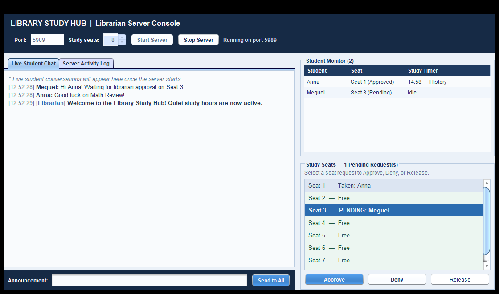
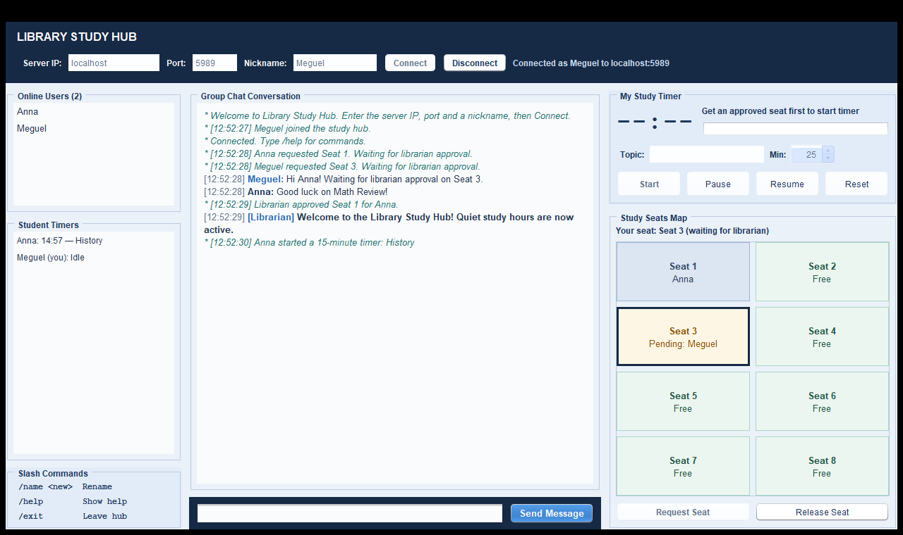

# Library Study Hub — Java LAN Chat Application (IAS 2112 Final Project)

## 1. Project Overview
**Library Study Hub** is a multi-client Java TCP socket application built for small library study groups collaborating inside a physical library over a local area network (LAN). In addition to real-time group chat, online student tracking, and command handling (`/name`, `/exit`, `/help`), it provides two synchronized study features managed by the server in memory:
1. **Per-Student Study Timers (Requires Approved Seat)** — Once a student holds an approved study seat, they can start their own independent countdown duration and study topic (`My Study Timer`), with `Start`, `Pause`, `Resume`, and `Reset` controls. Students without an approved seat cannot start a timer, and releasing a seat automatically resets any active timer. The server ticks every second and broadcasts everyone's live progress to the **Student Timers** sidebar on all connected clients.
2. **Study Seat Request, Librarian Approval & Monitoring Console** — An interactive seat map where students request free seats (`FREE` -> `PENDING`) or release their own seat, while the **Librarian Server Console (`ServerFrame`)** monitors live student conversations, sends official `[Librarian]` announcements to all students, tracks every student's live seat and timer status in the **Student Monitor** table, and approves (`TAKEN`), denies (`FREE`), or releases seats. All changes synchronize instantly across all connected clients, and disconnecting automatically frees a student's seat.

Both the Server and Client GUIs are built with **NetBeans Swing GUI Builder (`.form` drag-and-drop files)**, styled with an eye-comfort slate-navy & mist-blue theme, use **in-memory data only (no database)**, and load all default settings and theme colors from [`config.properties`](src/main/resources/librarystudyhub/config.properties) (or an optional external `studyhub.properties` file) so no configuration values are hard-coded in the Java source.

---

## 2. Team Members & Course Information
| Role | Full Name | GitHub Username | Course & Section |
| :--- | :--- | :--- | :--- |
| Partner 1 | Alexander G. Banton | [`@ZanyClaire`](https://github.com/ZanyClaire) | IAS 2112 Network Programming — BSIT 2B-SD |
| Partner 2 | Jharem S. Cante | [`@JCante2501`](https://github.com/JCante2501) | IAS 2112 Network Programming — BSIT 2B-SD |

### Contribution Log
| Date | Member | Task Description | Commit Link |
| :--- | :--- | :--- | :--- |
| 2026-11-10 | Alexander G. Banton (`@ZanyClaire`) | Wire protocol (`Protocol`), server core (`ChatServer`, `ClientHandler`, `Seat`), external configuration (`AppConfig`, `config.properties`), and Librarian Server Console (`ServerFrame.form`) | *(update with commit URL after push)* |
| 2026-11-18 | Jharem S. Cante (`@JCante2501`) | Client networking (`ClientConnection`), Student Desktop Workspace (`ClientFrame.form`), per-student study timers UI, seat map interactions, and multi-client LAN testing | *(update with commit URL after partner push)* |
| 2026-11-21 | Alexander G. Banton (`@ZanyClaire`) | Librarian live chat monitor, broadcast announcements, live Student Monitor table, approved-seat timer lock, and eye-comfort theme redesign | *(update with commit URL after push)* |

---

## 3. Concept Proposal & Instructor Approval
- **Theme & Project Name:** Library Study Hub
- **Target Audience:** Small library study groups (2–10 students) collaborating silently inside a physical school/campus library on the same Wi-Fi/LAN.
- **User Problem:** Ordinary chat apps do not let library study groups coordinate limited study table seats with librarian approval or track each student's individual study focus countdown side-by-side without speaking aloud.
- **Original Feature 1 — Independent Per-Student Study Timers (Seat-Gated):** Once a student's seat is approved by the Librarian, they can start their own focus timer with a custom duration and topic (e.g., 15 minutes for `History`, 25 minutes for `Math Review`). Students without an approved seat cannot start a timer, and releasing a seat resets any active timer. The server ticks all running timers once per second and broadcasts `TIMERS` updates so every client sees classmates' live countdowns in **Student Timers** and the Librarian sees them in the **Student Monitor** table.
- **Original Feature 2 — Study Seat Request, Librarian Approval & Live Monitoring:** The server maintains the library seat table. Students click a free seat and click **Request Seat** (`PENDING`). On the **Librarian Server Console**, the librarian monitors live student chat, sends official `[Librarian]` announcements, views pending seat requests, and clicks **Approve** (`TAKEN`), **Deny** (`FREE`), or **Release** (`FREE`). All clients immediately receive the updated `SEATS` map, and disconnecting automatically frees any held seat.
- **Sample Screens:** See **Section 7 (Labeled Application Screenshots)** below for the Librarian Server Console (`screenshots/server.png`), Student Workspace with Approved Seat & Running Timer (`screenshots/client-anna.png`), and Student Workspace with Pending Seat & Locked Timer (`screenshots/client-meguel.png`).
- **Instructor & Approval Status:** Kent Joshua Espina — **Pending**

---

## 4. Architecture & Message Format

```
+-------------------+          TCP Socket (UTF-8 lines)          +---------------------------+
|   ClientFrame     |  <-------------------------------------->  |    ChatServer             |
| (Swing EDT +      |   HELLO / CHAT / CMD / TIMER_* / SEAT_*    | (ServerSocket +           |
|  ClientConnection)|                                            |  ClientHandler per client |
+-------------------+                                            |  + 1s Timer Ticker +      |
                                                                 |  Librarian ServerFrame)   |
                                                                 +---------------------------+
```

### Wire Protocol (`common.Protocol`)
Every message is a single UTF-8 line terminated by `\n`:
```
TYPE|field1|field2|...
```
Special characters inside fields are escaped (`\` -> `\\`, `|` -> `\p`, `\n` -> `\n`, `\r` -> `\r`) so user chat text can never corrupt a frame.

#### Client -> Server Messages
| Type | Format | Description |
| :--- | :--- | :--- |
| `HELLO` | `HELLO\|nickname` | Initial handshake sent immediately after TCP connect |
| `CHAT` | `CHAT\|text` | Broadcast a chat message to the group and Librarian chat monitor |
| `CMD` | `CMD\|/name <newname>` \| `/exit` \| `/help` | Execute a slash command validated by the server |
| `TIMER_START` | `TIMER_START\|minutes\|label` | Start this student's own study timer (requires an approved seat) |
| `TIMER_PAUSE` | `TIMER_PAUSE` | Pause this student's running timer |
| `TIMER_RESUME` | `TIMER_RESUME` | Resume this student's paused timer |
| `TIMER_RESET` | `TIMER_RESET` | Reset this student's timer back to `IDLE` |
| `SEAT_REQUEST` | `SEAT_REQUEST\|seatNo` | Request a free study seat (1-based index) |
| `SEAT_RELEASE` | `SEAT_RELEASE\|seatNo` | Release the student's own `PENDING`/`TAKEN` seat (auto-resets active timer) |

#### Server -> Client Messages
| Type | Format | Description |
| :--- | :--- | :--- |
| `WELCOME` | `WELCOME\|nickname` | Handshake accepted |
| `REJECT` | `REJECT\|reason` | Handshake rejected (invalid, reserved `Librarian`, or duplicate nickname) |
| `NICK` | `NICK\|newNickname` | Confirms the caller's `/name` change succeeded |
| `CHAT` | `CHAT\|HH:mm:ss\|sender\|text` | Group chat message or `[Librarian]` announcement broadcast once to all clients |
| `SYSTEM` | `SYSTEM\|HH:mm:ss\|text` | Join, leave, rename, timer, and seat event notices |
| `INFO` | `INFO\|text` | Private command output (e.g., `/help`) |
| `ERROR` | `ERROR\|text` | Validation error returned to the requesting client |
| `USERS` | `USERS\|nick1\|nick2\|...` | Full online students list |
| `TIMERS` | `TIMERS\|nick1\|state1\|rem1\|tot1\|label1\|...` | Synchronized per-student timer snapshots |
| `SEATS` | `SEATS\|count\|status1\|holder1\|status2\|holder2\|...` | Synchronized seat table snapshot |
| `BYE` | `BYE\|reason` | Clean disconnect or server shutdown notice |

---

## 5. Setup, Drag-and-Drop GUI Editing & Running Instructions

### Requirements
- **Java Version:** JDK 17 or newer (tested on JDK 26). No external libraries or databases required.
- **IDE (for Drag-and-Drop GUI Builder):** Apache NetBeans (open the project folder directly; double-click `ServerFrame.java` or `ClientFrame.java` and switch to the **Design** tab to drag and drop Swing components).
  - After pulling updates, right-click the project in NetBeans → **Clean and Build** before running.

### Option A — Quick Start on Windows (Batch Scripts)
1. Double-click **`run-server.bat`** and click **Start Server**.
2. Double-click **`run-client.bat`** three times (or across two LAN computers) to open three client windows.
3. Enter the Server IP (`localhost` on the same PC, or the LAN IP shown in the **Server Activity Log** tab when connecting from another computer on the same Wi-Fi/LAN), port (`5050`), and a unique nickname, then click **Connect**.

### Option B — Command Line (`javac` / `java`)
```powershell
mkdir target\classes -Force
javac -encoding UTF-8 -d target\classes src\main\java\common\*.java src\main\java\server\*.java src\main\java\client\*.java
Copy-Item -Recurse -Force src\main\resources\* target\classes\

# Start Librarian Server Console:
java -cp target\classes server.ServerFrame

# Start Student Client (run in 3 terminals / across 2 LAN machines):
java -cp target\classes client.ClientFrame
```

### Troubleshooting LAN Connections
- Open the **Server Activity Log** tab in `ServerFrame` — the first line prints the machine's active LAN IPv4 address(es) (e.g., `192.168.x.x`).
- If a second laptop cannot connect, ensure both laptops are on the same Wi-Fi/hotspot and allow Java through Windows Defender Firewall on TCP port `5050` (or override `server.port` in `studyhub.properties`).

---

## 6. Supported Commands
| Command | Example | Behavior |
| :--- | :--- | :--- |
| `/name <newname>` | `/name Anna_2` | Validates uniqueness, reserved names (`Librarian`), and format (`2-16` letters, digits, or `_`), updates online list, timers, Student Monitor table, seat holder tags, and notifies all clients |
| `/help` | `/help` | Displays available commands and study hub feature instructions |
| `/exit` | `/exit` | Cleanly disconnects from the server, frees any held seat & active timer, and updates remaining clients |

---

## 7. Labeled Application Screenshots

### Librarian Server Console (`ServerFrame`)
Shows **Live Student Chat**, **Librarian Announcement bar**, **Server Activity Log** tab, **Student Monitor** table (`Student | Seat | Study Timer`), and **Study Seats — Librarian Approval** controls:



### Student Desktop Workspace — Approved Seat & Active Timer (`ClientFrame`)
Shows `Anna` with approved `Seat 1`, an active 15-minute `History` timer, live `Student Timers`, and a `[Librarian]` announcement in chat:


### Student Desktop Workspace — Pending Seat & Locked Timer (`ClientFrame`)
Shows `Meguel` with pending `Seat 3` (`waiting for librarian`) where `My Study Timer` stays locked until the Librarian approves the seat:



---

## 8. Minimum Test Cases & Results
| # | Test Case | Steps | Expected Result | Actual Result | Status |
| :- | :--- | :--- | :--- | :--- | :--- |
| 1 | Three concurrent clients | Connect `alice`, `bob`, and `cara` to the server | All 3 connect; online list & Student Monitor table show all 3 students | All 3 connected and listed | **PASS** |
| 2 | Group chat broadcast & server monitor | `bob` sends a chat message (including `\|` and newlines) | Message appears once on all 3 clients and in Librarian **Live Student Chat** with timestamp and sender | Broadcast received once everywhere; escaping preserved | **PASS** |
| 3 | Duplicate / invalid / reserved nickname | Connect as `Bob`, blank, or `Librarian`; or run `/name alice` | Server rejects duplicate (case-insensitive), blank, and reserved `Librarian` nicknames | Rejected with clear error message | **PASS** |
| 4 | Valid `/name` change | `bob` sends `/name bobby` | Nickname updates in chat, online list, timers, Student Monitor table, and held seat across all clients | Updated everywhere | **PASS** |
| 5 | Blank message rejection | Click **Send Message** (or **Send to All**) with empty/whitespace input | Client & server reject blank messages and show warning | Rejected with error notice | **PASS** |
| 6 | Invalid IP / port / unavailable server | Enter port `99999` or connect while server is stopped | GUI stays responsive; friendly error dialog explains the failure | Error dialog shown, GUI responsive | **PASS** |
| 7 | Clean `/exit` | Send `/exit` from `bobby` | Client disconnects cleanly; seat & timer are cleared and online list updates for remaining clients | Disconnected and state updated | **PASS** |
| 8 | Abrupt client disconnection | Close `alice`'s socket/window abruptly | Server detects EOF, frees `alice`'s seat & timer, and chat continues between remaining clients | Handled cleanly, chat continues | **PASS** |
| 9 | Original Feature 1: Per-Student Study Timers (Seat-Gated) | Try starting timer without seat or while `PENDING`; then after Librarian approves seats, Student 1 starts 15-min (`History`) and Student 2 starts 25-min (`Calculus`); Student 1 releases seat | Timer blocked until seat is approved; independent countdowns sync to **Student Timers** and **Student Monitor**; releasing seat resets active timer | All 6 sub-checks verified and synchronized | **PASS** |
| 10 | Original Feature 2: Study Seats, Librarian Approval & Announcements | Student 1 requests Seat 1 (`PENDING`); Librarian approves (`TAKEN`) and sends announcement; Student 2 requests Seat 3 (`PENDING`); Librarian denies (`FREE`) | Seat colors, pending counts, Student Monitor table, and `[Librarian]` announcements synchronize across all clients and server | Synchronized across all clients & server | **PASS** |

---

## 9. References, Libraries & AI Assistance
- **Java SE Standard Library (JDK 17+):** `java.net` (`ServerSocket`, `Socket`), `javax.swing` (Swing GUI & `SwingWorker`), `java.util.concurrent` (`ExecutorService`, `ScheduledExecutorService`), `java.time`. No third-party runtime libraries or external databases are used.
- **Apache NetBeans IDE & Matisse GUI Builder:** Used for designing and editing `ServerFrame.form` and `ClientFrame.form` via drag-and-drop Swing forms and Maven project configuration (`pom.xml`).
- **AI Assistance:** Google Antigravity AI assistant was used to help refine the TCP wire protocol, Swing UI layout/theme styling, automated multi-client socket tests, and documentation structure. Both team members reviewed, tested, and verified all source code and can explain the full client-to-server-to-client message path.
